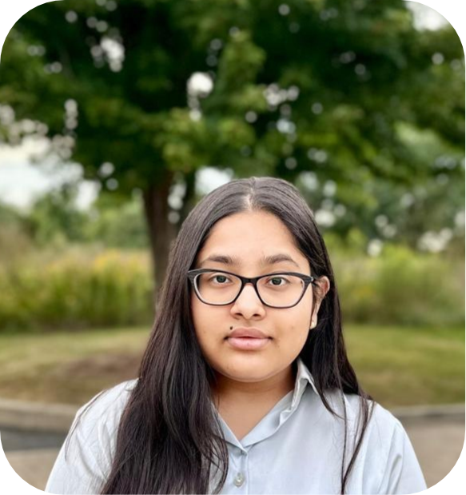

## Hi There! 

Computer Science Freshman at UIC ‘29 | Seeking Software Engineering and Data Science & Machine Learning Opportunities | Passionate About Building Educational Tech & Web Development 

About me:
Hi! I’m a student at the University of Illinois Chicago, currently pursuing a degree in Computer Science with a concentration in Software Engineering. My interest in technology started long before I knew I wanted to study computer science. In fact it started with a love for math. I’ve always enjoyed the logic behind math and the satisfaction of working through a particularly difficult problem until everything finally clicks. That curiosity and love for problem-solving eventually led me to computer science. I began to see programming as another way to take a complex problem, break it down logically, and build something useful from it. Now at UIC, I’m developing that interest through coursework in programming, mathematical foundations of computing, linear algebra, and technical communication while continuing to explore software development outside the classroom through personal work and several interest groups. As I continue through college, I’m looking for opportunities to turn what I’m learning into tools that are genuinely useful to people. My goal is to contribute to real-world development teams through software engineering internships, and to continue building projects that challenge me to think both technically and creatively.

Table of Contents: 

1. Clock-In: A web-based study tracking application built with Python, Flask, and SQLite that allows students to record study sessions, organize their work by course, and analyze their study habits.

<!--
**JasmithaK/JasmithaK** is a ✨ _special_ ✨ repository because its `README.md` (this file) appears on your GitHub profile.

Here are some ideas to get you started:

- 🔭 I’m currently working on ...
- 🌱 I’m currently learning ...
- 👯 I’m looking to collaborate on ...
- 🤔 I’m looking for help with ...
- 💬 Ask me about ...
- 📫 How to reach me: ...
- 😄 Pronouns: ...
- ⚡ Fun fact: ...
-->
